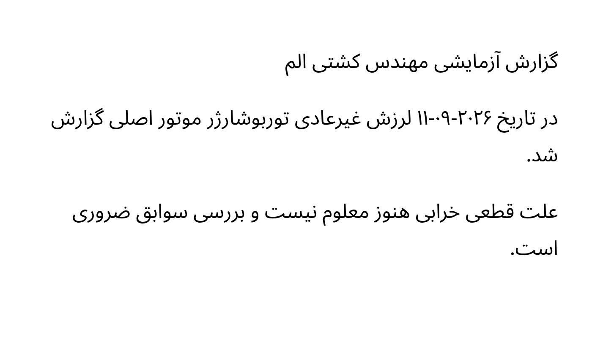

# HM-05 bounded bilingual reviewer packet / بستهٔ محدود بررسی دوزبانه

**PENDING INDEPENDENT REVIEW — NO ACCEPTANCE / در انتظار بررسی مستقل؛ تأیید نشده**

One page, three authored synthetic paragraphs, one exact persisted machine
transcript. All material is invented/public HM-05 regression material, not
customer Evidence, an unseen benchmark, or an independently adjudicated gold
reference. The English explanations below are working engineering translations,
not expert-certified translations. No coverage or causation conclusion is sought.

تمام مطالب این بسته ساختگی است. ترجمهٔ انگلیسی صرفاً راهنمای مهندسی است و
تأیید مترجم یا کارشناس مستقل ندارد. این بسته مجوز تصمیم بیمه‌ای نیست.

## Files and source locators / فایل‌ها و نشانی منابع

- [Original raster / تصویر اصلی](original.png): unchanged original PNG recovered
  from the synthetic Evidence store; SHA-256
  `1eef5de99985ee76048f93b04b7184c9a5daf4b6f33441b36c99e9a850e56d4c`.
- [Authored synthetic source / متن مبنای ساختگی](authoritative-source.txt): the
  exact three `source_lines` in the fixed HM-05 fixture; not a human gold transcript.
- [Exact persisted machine text / متن دقیق ذخیره‌شدهٔ ماشین](machine-transcript.txt):
  byte-identical UTF-8 export, no added final newline, normalization or correction;
  SHA-256 `5a2304f4b11d628d7694eb38e24d8d335bf8dbf31e0e0b5cb639bc2cd0bd3cd2`.
- [Exact discrepancies / اختلاف‌های دقیق](exact-discrepancies.json): character
  edits and end-exclusive UTF-16 offsets, preserving raw machine line numbers.
- [Manifest](manifest.json), [checksums](SHA256SUMS), and
  [blank review record / فرم تکمیل‌نشده](review-record.pending.json).

Source locator: **HM-05, document version 1, page 1, extraction segment 0**.
The three source paragraphs map to nonempty raw machine lines 1, 3 and 5.
Blank lines remain unchanged in the machine file. No tenant/customer identifiers
or credentials are included. Verify files with `sha256sum -c SHA256SUMS`.



## Exact clause boundary / مرز دقیق عبارت

Authored paragraph 3 / پاراگراف سوم متن مبنا:

> علت قطعی خرابی هنوز معلوم نیست و بررسی سوابق ضروری است.

Persisted machine line 5 / خط پنجم متن ذخیره‌شده:

> علت قطعی خرابی هنوز معلوم نیست و بررسی سوابق ضروری

Engineering observation: the token **`نیست` is present**. The missing tail is
**` است.`**, source paragraph-3 UTF-16 offsets **[50, 55)**, not a demonstrated
loss of `نیست` in this run. Paragraph 2 also loses **` شد.`** at **[60, 64)**.
Both short continuation endings are visible as separate wrapped lines in the
original raster viewed during engineering diagnosis. A reviewer must independently
confirm the visual reading and its significance; this observation is not a
professional source-fidelity signoff.

در این اجرا «نیست» موجود است؛ پایان « است.» از عبارت سوم و « شد.» از عبارت
دوم در متن ماشین نیامده است. مشاهدهٔ مهندسی جای تأیید مستقل کارشناس را نمی‌گیرد.

Working translation of the authored clause: “The definite cause of the failure
is not yet known, and review of records is necessary.” This is a translation of
an invented source statement, **not a finding about a real casualty**. Do not
restore the missing ending by assumption or use the incomplete machine clause
to infer a causal or insurance conclusion.

The authored logical date is `۲۰۲۶-۰۹-۱۱`; the machine sequence is `۱۱-۰۹-۲۰۲۶`.
The raster itself displays the latter visual order under RTL layout. Its reading
and relationship to the logical source date require bilingual adjudication;
**do not attribute this difference to OCR alone, normalize it silently, or infer
the intended incident date**.

ترتیب تاریخ در متن مبنا و خروجی ماشین متفاوت است و خود تصویر نیز باید بررسی
شود. بدون داوری دوزبانه، تاریخ را تصحیح یا علت اختلاف را فقط OCR اعلام نکنید.

## Evidence limits and Docker replay / محدودیت شواهد و اجرای Docker

The native observation used Tesseract 5.5.0 and repository-pinned eng/fas data.
A second direct native OCR run exactly matched the persisted text hash. This
localizes this run's lost endings before persistence, without proving why the
engine omitted them. Original-source comparison remains required; the Assessment
was preliminary and unapproved. No model, transcript repair or human attestation
was supplied.

**Selected Docker worker reproduction is NOT COMPLETE.** Only PostgreSQL and
ClamAV images were cached. The selected worker must be built from the committed
`apps/api/Dockerfile`, target `worker`, at main
`fa2c471463f5aecb988f89e791aae359385227e4`, including its pinned Tesseract commit
`8ae68101439b3f7df123499a784e8896c805179d` and existing library/language-data
verification. Alpine and Poppler build-source destinations were denied by the
proxy; LibTIFF's `download.osgeo.org` is also a required source destination.
The necessary development-domain additions were saved in the pending environment
draft, preserving `api.github.com`; they are **not applied** to the running policy.
No costly build was started with those prerequisites denied. Never substitute
the native result for the selected hardened Docker runtime.

Once the environment owner applies access, build the unchanged Docker target
with supported proxy CA mounts and all original package/artifact/TLS checks.
Record checkout/tree, image ID/digest, Tesseract version/commit and language hashes.
Then perform a direct, network-disabled OCR replay of this exact raster, for example:

```bash
# Use the verified worker image built above; do not substitute another image.
set -o noclobber
docker run --rm --network none --read-only --user 1000:1000 \
  --cap-drop ALL --security-opt no-new-privileges:true \
  --tmpfs /tmp:rw,nosuid,nodev,size=64m,mode=1777 \
  --mount "type=bind,src=$PWD,dst=/review,readonly" \
  --entrypoint tesseract "$VERIFIED_HM05_WORKER_IMAGE" \
  /review/original.png stdout -l eng+fas > ../hm05-docker-machine-transcript.pending.txt
```

Run that command from this packet directory, keep new runtime output separate
from the original packet, and record its hash. Next run the selected image through
ordinary worker extraction and verify its stored source/version/locator/hold state.
Neither engine-only replay nor an improved token count independently clears a hold.

## Bounded review questions / پرسش‌های محدود بررسی

1. Can you identify `است.` and `شد.` in the original wrapped lines, and confirm
   the exact machine omissions? / آیا پایان‌های «است.» و «شد.» در تصویر مشخص
   هستند و حذف دقیق آن‌ها از متن ماشین تأیید می‌شود؟
2. Does the incomplete third paragraph preserve the source's uncertainty and
   negation scope? Mark any ambiguity without giving a causal conclusion. /
   آیا عبارت ناقص، عدم قطعیت و دامنهٔ نفی را حفظ کرده است؟ ابهام را بدون نتیجه‌گیری
   دربارهٔ علت خرابی مشخص کنید.
3. How should the date in the raster be read, and how does it relate to the
   logical authored sequence? / تاریخ تصویر چگونه خوانده می‌شود و چه نسبتی با
   ترتیب منطقی متن مبنا دارد؟
4. Are technical terms, sentence endings or paragraph boundaries otherwise
   changed? Cite paragraph, machine line and image position. / آیا اصطلاح فنی، پایان
   جمله یا مرز دیگری تغییر کرده است؟ محل را در متن و تصویر مشخص کنید.
5. What exact source-linked corrections would be needed before professional use?
   Record annotations separately; never rewrite the preserved machine file. /
   پیش از استفادهٔ حرفه‌ای چه اصلاح مستندی لازم است؟ یادداشت‌ها را جدا نگه دارید و
   فایل اصلی خروجی ماشین را بازنویسی نکنید.
6. What remains unsupported, and what additional source/review is required? /
   چه چیزی هنوز پشتوانه ندارد و به چه منبع یا بررسی دیگری نیاز است؟

## Authorized completion / تکمیل مجاز

The blank record is **pending**, with no reviewer named or decision prefilled.
A real authorized bilingual H&M reviewer must examine the original and exact
transcript, record a private reviewer/authorization reference and independence,
answer the questions, and bind a dated workpaper to these hashes/locators through
the existing governed review process. Do not publish personal or customer data
in this repository. Filling this template or attaching a hash is not itself an
application approval, dispute resolution, Assessment approval or Pilot GO.

فرم عمداً تکمیل نشده است. فقط بازبین واقعی و مجاز می‌تواند نتیجه را با نشانی
منبع و مرجع مجوز ثبت کند. تکمیل فرم به‌تنهایی قفل بررسی، اختلاف منبع یا ارزیابی
را تأیید و رفع نمی‌کند. پذیرش مستقل همچنان **در انتظار** است.
